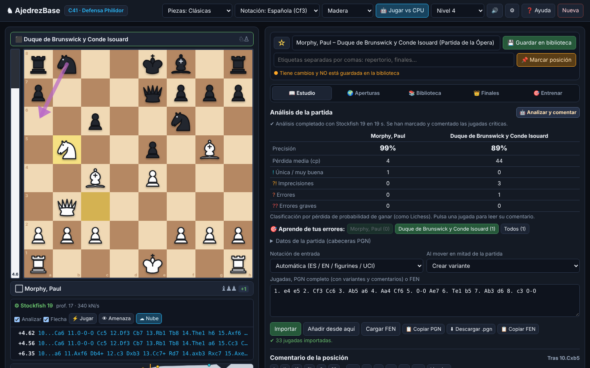

# AjedrezBase

Analiza, comenta y entrena **tus partidas de ajedrez** en el navegador: variantes, PGN completo, motor Stockfish,
aperturas, finales, biblioteca con marcadores y repaso con repetición espaciada. Todo en **español** y en
**un único archivo HTML**: sin servidor, sin cuentas y sin instalar nada. Tus partidas se quedan en tu navegador.

### ▶️ [Abrir en el navegador](https://rkarillo-tech.github.io/ajedrezbase/) · [Descargar el HTML](https://github.com/rkarillo-tech/ajedrezbase/raw/main/index.html) · [Guía de uso](GUIA.md)

> La versión web se puede **instalar como aplicación** (botón «⬇ Instalar» o «Añadir a pantalla de inicio» en el móvil)
> y entonces **funciona sin conexión**, Stockfish incluido.
> Si prefieres el archivo suelto, guárdalo donde quieras y ábrelo con Chrome, Edge, Firefox o Safari.



## Qué incluye

| | |
| --- | --- |
| **Tablero** | Arrastrar o clic-clic, coronación a elegir, flechas y círculos de colores (clic derecho), 4 estilos de piezas y 5 temas |
| **Variantes** | Árbol completo: variantes anidadas, promover, hacer principal, cortar; comentarios y símbolos `!` `?` `±`… en cada jugada |
| **PGN** | Importa notación española (`Cf3`), inglesa, figurines, coordenadas y PGN completos de Lichess, Chess.com o ChessBase; exporta PGN estándar |
| **Motor** | Stockfish 19 (NNUE) en el navegador: hasta 3 líneas, flecha, barra de evaluación y **👁 Ver amenaza** (`X`); nube de Lichess y motor propio de respaldo sin conexión |
| **Análisis** | Analiza la partida (o una variante): marca `??` `?` `?!` `!`, redacta comentarios en español, calcula la precisión y dibuja el gráfico |
| **Aprende de tus errores** | Tras el análisis, repasa cada `?` y `??` buscando tú la jugada buena; acepta alternativas casi igual de buenas y guarda los que quieras como tarjetas |
| **Aperturas** | Explorador de Lichess (maestros y online), explorador de **tus propias partidas** sin conexión y 170 aperturas ECO en español |
| **Finales** | Tablas Syzygy de 7 piezas con práctica contra la defensa perfecta, y finales fundamentales (Lucena, Philidor, Saavedra…) |
| **Biblioteca** | Guardas sólo lo que te interesa: ⭐ favoritas, etiquetas, buscador, borrado individual, exportar y copias de seguridad |
| **Marcadores** | 📌 Marca posiciones como idea, táctica, error típico, plan… con nota; búscalas y vuelve a ellas con un clic |
| **Entrenar** | Repertorio contra tus variantes y **tarjetas** de tus marcadores, con repetición espaciada (1, 3, 7, 16, 35, 75 días) |
| **Compartir** | Imagen PNG de la posición (también al portapapeles), impresión o PDF de la partida comentada con diagramas, y enlace que abre la partida en una jugada |
| **Más** | Editor de posición arrastrando piezas, jugar contra la CPU (8 niveles), jugar escribiendo la jugada, planilla de dos columnas, rueda del ratón, ficheros `.pgn` de miles de partidas, medidor de memoria |

## Cómo se usa

1. Pega una partida (PGN o jugadas sueltas, en español o en inglés) en **📖 Estudio** y pulsa **Importar**.
   También puedes jugar directamente en el tablero o abrir un `.pgn` en **📚 Biblioteca › 🗂 Abrir .pgn**.
2. Recórrela con `←` `→`. El motor analiza cada posición; activa o pausa el análisis con `E`.
3. Pulsa **🤖 Analizar y comentar** para que marque los errores, escriba comentarios y calcule la precisión.
   Después, **🎯 Aprende de tus errores** te pide que encuentres tú la jugada buena en cada error.
4. Añade tus variantes moviendo en el tablero, tus comentarios y tus flechas.
5. Si la partida te interesa, **💾 Guardar en biblioteca**. A partir de ahí sus cambios se guardan solos.
6. Marca con **📌** (o `M`) las posiciones que quieras recordar y repásalas en **🎯 Entrenar › Tarjetas**.

Todo está explicado con ejemplos en la **[guía de uso](GUIA.md)**, que también está dentro de la aplicación (botón **❓ Ayuda** o tecla `?`).

## Atajos

`←` `→` jugada anterior / siguiente · `↑` `↓` cambiar de variante · `Inicio` `Fin` · `Espacio` reproducir ·
`F` girar el tablero · `E` análisis on/off · `X` ver amenaza · `M` marcar posición · `?` ayuda · `Esc` cerrar ·
rueda del ratón sobre el tablero para avanzar y retroceder.

## Preguntas frecuentes

**¿Dónde se guardan mis partidas?** Sólo en tu navegador (IndexedDB). Nada se sube a ningún servidor.
La biblioteca depende del navegador y de la dirección: no es la misma en la versión web que en el archivo descargado.
Para pasarla de un sitio a otro, usa **⬇ Copia de seguridad** y **⬆ Restaurar copia**.

**¿Se guarda todo lo que importo?** No. Importar o abrir un `.pgn` no guarda nada; sólo lo que guardas con 💾.
En **📚 Biblioteca** tienes un medidor de lo que ocupa todo.

**¿Necesito internet?** Instalada desde la versión web, no: la aplicación y Stockfish quedan guardados.
Sólo necesitan conexión el explorador de Lichess, la evaluación en la nube y las tablas Syzygy.

**El explorador de aperturas dice que falta un token.** Lichess exige ahora un token personal gratuito.
Créalo **sin marcar ningún permiso** en [lichess.org › API access tokens](https://lichess.org/account/oauth/token/create?description=AjedrezBase)
y pégalo en **⚙ Ajustes** (botón «🔌 Probar token»). Se guarda sólo en tu navegador. Mientras tanto puedes usar
el explorador de tus propias partidas o la enciclopedia ECO, que funcionan sin conexión.

**¿Qué motor usa?** Stockfish 19 Lite (WebAssembly, con red neuronal NNUE; 1,9 MB). Si el navegador no puede, pasa a
Stockfish 10 y, sin conexión la primera vez, al motor propio.

**Sale «Motor interno ⚠» en vez de Stockfish.** El navegador no ha dejado arrancar Stockfish (suele pasar al abrir el
archivo en una vista previa). Usa la versión web o abre el archivo directamente con el navegador.

**¿Puedo usarlo, modificarlo o compartirlo?** Sí, con licencia MIT (ver abajo).

**¿Hay soporte?** Es un proyecto personal que se comparte tal cual, sin garantía.

## Licencia

[MIT](LICENSE) © 2026 Rafael Karino Arillo ([rkarillo-tech](https://github.com/rkarillo-tech)).
Puedes usarlo, copiarlo, modificarlo y distribuirlo libremente, manteniendo el aviso de autoría.
Componentes y servicios de terceros: ver [THIRD_PARTY_NOTICES.md](THIRD_PARTY_NOTICES.md).
Stockfish (GPL v3) **no** forma parte de este repositorio: el navegador lo descarga de jsDelivr (o cdnjs) al usarlo.

---

## Para desarrolladores

`index.html` se genera a partir de `src/` con un script sin dependencias. No hay compilación ni paquetes npm.

```
build.py              Une src/ en index.html y genera sw.js, sf-worker.js y GUIA.md
VERSION               Número de versión
index.html            La aplicación completa (generada: no editar a mano)
manifest.webmanifest  Datos para instalarla como aplicación
sw.js                 Service worker: uso sin conexión (generado desde src/sw.js)
sf-worker.js          Lanzador de Stockfish (19 o 10) desde el mismo origen, para poder guardarlo sin conexión
src/template.html     Plantilla con estilos y marcadores {{...}}
src/core.js           Reglas (tablero 0x88), SAN multilingüe, evaluación y motor alfa-beta propio (también corre en un Worker)
src/pgn.js            Árbol de variantes y lector/escritor PGN ([%cal], [%csl], [%eval], NAG)
src/eco.js            Libro ECO en español, finales clásicos y antología de partidas
src/pieces.js         Dibujo de las piezas
src/app.js            Interfaz, motor, análisis, biblioteca (IndexedDB), marcadores, entrenador
src/help.html         Guía de uso (también se exporta a GUIA.md)
assets/               Icono (icon.svg y sus PNG, generados con tools/gen_icons.py) y captura
notas/                Notas de cada versión
tests/                Pruebas del núcleo (Node) y de extremo a extremo (Playwright)
```

**Principios:** un solo archivo que funciona con doble clic; nada sale del navegador salvo las consultas a Lichess
que el usuario pide; nada se guarda sin que el usuario lo pida; reglas verificadas con *perft* contra valores de referencia.

```bash
python3 build.py                                   # genera index.html, sw.js, sf-worker.js y GUIA.md
python3 -m pip install playwright
python3 -m playwright install chromium
tests/run_all.sh                                   # todas las pruebas

# Opcional: probar también con el Stockfish 19 real (sin depender de la red durante la prueba)
npm pack stockfish@19.0.1 && mkdir -p /tmp/sf && tar xzf stockfish-19.0.1.tgz -C /tmp/sf
STOCKFISH_DIR=/tmp/sf/package/bin python3 tests/test_app.py
```

Para publicar una versión: sube `VERSION`, añade `notas/vX.Y.Z.md`, ejecuta `python3 build.py` y crea una
Release `vX.Y.Z` en GitHub; la acción adjunta `ajedrezbase.html` y su huella SHA-256.
